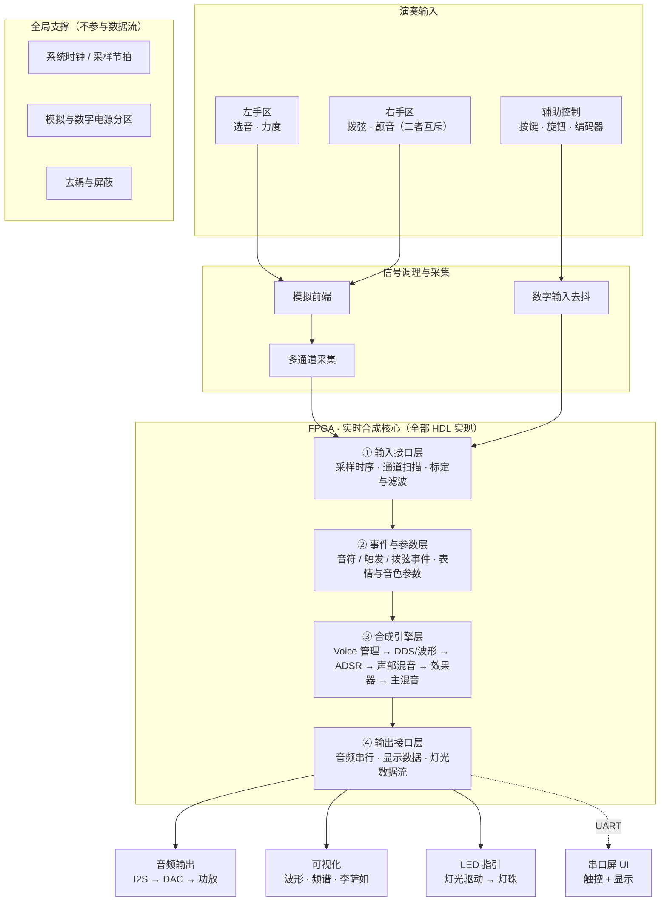

# 电子乐器系统 · 整体模块框图

> **用途**：给队友看"系统由哪些模块组成、数据怎么流"
> **口径**：**只描述模块层级，不涉及具体型号**（型号待选型文档冻结后再落）
> **日期**：2026-09-12
> **配套**：`FPGA电子乐器项目-交接文档-v2.0-过时.md`（总纲）｜`方案选择档案-过时-中立对比版.md`（器件选型）｜**`硬件接口总表.md`（排针依据）**｜**`模块决策表.md`（逐模块拍板）**｜**`左手区方案.md`**｜`音频输出方案.md`｜`LED演奏指引方案.md`｜`电源方案.md`｜`FPGA平台与资源评估.md`

---

## 一、主链路：输入 → 处理 → 输出



### ASCII 版（不方便渲染 Mermaid 时看这里）

```text
┌────────── 演奏输入 ──────────────────────────────────────┐
│  左手区            右手区              辅助控制            │
│  选音 · 力度       拨弦 · 颤音（互斥）  按键/旋钮/编码器    │
└──────┬────────────────┬──────────────────────┬───────────┘
       ▼                ▼                      ▼
┌────────── 信号调理与采集 ─────────────────────────────────┐
│  模拟前端 ── 多通道采集          数字输入去抖              │
└───────────────────────┬───────────────────────────────────┘
                        ▼
╔══════════ FPGA · 实时合成核心（全部 HDL 实现）══════════════╗
║ ① 输入接口层   采样时序 · 通道扫描 · 标定与滤波            ║
║        ▼                                                  ║
║ ② 事件与参数层 音符 / 触发 / 拨弦事件 · 表情与音色参数   ─╫─→ 串口屏 UI（UART，非演奏通路）
║        ▼                                                  ║
║ ③ 合成引擎层   Voice 管理 → DDS/波形 → ADSR 包络          ║
║                → 声部混音 → 效果器 → 主混音                ║
║        ▼                                                  ║
║ ④ 输出接口层   音频串行 · 显示数据 · 灯光数据流            ║
╚═══════╤═══════════════╤════════════════╤═══════════════════╝
        ▼               ▼                ▼
   ┌─────────┐    ┌──────────┐    ┌──────────┐
   │ 音频输出 │    │  可视化   │    │ LED 指引  │
   │I2S→DAC→ │    │波形·频谱· │    │灯光驱动 → │
   │ 功放音箱 │    │ 李萨如    │    │  灯珠     │
   └─────────┘    └──────────┘    └──────────┘

全局支撑（不参与数据流）：系统时钟/采样节拍 · 模拟与数字电源分区 · 去耦与屏蔽
```

---

## 二、各层职责

| 层 | 职责 | 边界 |
|---|---|---|
| **① 演奏输入** | 产生原始动作信号 | 硬件侧负责（传感器 + 机械结构） |
| **② 信号调理与采集** | 把物理量变成可用的数字量 | 硬件侧负责（模拟前端 + ADC / 触摸 IC / 去抖） |
| **③ FPGA 内部** | 事件识别 + 参数生成 + 实时合成 + 输出驱动 | 与 FPGA 侧分工，**硬件侧负责接口定义与时序约束** |
| **④ 输出** | 音频 / 视觉 / 灯光三类输出 | 硬件侧负责音频与灯光通路；可视化由 FPGA 侧生成数据 |
| **⑤ 全局支撑** | 时钟、电源、地、屏蔽 | 硬件侧负责 |

---

## 三、FPGA 内部四层拆解

| 层 | 输入 | 输出 | 关键点 |
|---|---|---|---|
| **① 输入接口层** | 采集到的原始数据 | 标定、滤波后的规范化量 | 采样时序必须**确定**；标定系数来自上电自校 |
| **② 事件与参数层** | 规范化量 | **音符事件** + **表情参数** | ⭐ 这两类**必须分开**：事件进 Note Manager，参数进 Parameter Manager，**参数永不产生音符** |
| **③ 合成引擎层** | 音符事件 + 参数 | 逐样本音频数据 | 全部 HDL 实现；**严禁播放预录 PCM** |
| **④ 输出接口层** | 音频数据 / 可视化数据 / 灯光数据 | 三路数字输出 | 三路并行，互不阻塞 |

> ⭐ **② 层的"事件 / 参数分离"是整个架构的关键设计**：
> - **事件**（选音、触发、拨弦）→ 驱动 Note ON/OFF
> - **参数**（力度、颤音、表情、音色）→ 持续调制
>
> 把这两类**在架构上分开**，可以避免"调制动作被误判成新的音符"——
> 这是"误触发"问题的**结构性解法**，不依赖算法判断。

---

## 四、两条不可违反的结构原则

| # | 原则 | 原因 |
|---|---|---|
| **1** | **演奏链路与 UI 链路必须分离** | 串口屏的触摸扫描 + UART 传输延迟**不可控**，不能进 ≤5 ms 的确定性通路。屏只做 UI，**不做演奏输入** |
| **2** | **左手区 / 右手区 / 颤音模块互相独立** | 三者由**不同的手或不同的动作**操作 → **不必共面、可以分板**（详见 `方案选择档案-过时-中立对比版.md` §2.2） |

---

## 五、延迟预算（按通路分级）

| 通路 | 延迟敏感度 | 说明 |
|---|---|---|
| **触发 / 拨弦 → 发声** | 🔴 最敏感 | 决定"音符什么时候响" |
| **选音 / 音高** | 🟠 敏感 | 延迟 = 音符迟到；抖动 = 音高不稳 |
| **力度** | 🟡 中 | 与触发时刻绑定，取触发瞬间值即可 |
| **颤音 / 调制** | 🟢 不敏感 | 低频调制，几十 ms 更新听不出来 |
| **可视化 / LED 指引** | ⚪ 无要求 | 只要视觉上同步即可 |

> ➡️ **分配原则**：把"延迟不确定"的器件，分配到**唯一不敏感**的通路上。

---

## 五之二、⭐ ③ 合成引擎层细化（A2 决策后，2026-09-13）

> **依据**：`files/20-代码/合成引擎架构决策.md`
> **要解决的问题**：评分规则写着「独立发声单元为含**独立相位累加器 + 频率调控 + 包络控制**的完整振荡器；
> **单波表查表仅计 1 个振荡器**」—— 于是**"音色怎么做"与"能报多少吞吐量"是同一件事**。

### 层内结构

```text
③ 合成引擎层
   Note Manager（音符事件 → 声部分配）
        │
        ▼
   ┌──────────── 每个 Voice（复音单元）重复 N 份 ────────────┐
   │  振荡器 ×OSC_PER_VOICE（默认 2，可退 1）                │
   │    ├─ 相位累加器   ← 每振荡器【私有】⭐ 规则要求         │
   │    ├─ 频率调控     ← 每振荡器【私有】⭐ 规则要求         │
   │    └─ 波表查表     ← 表 ROM 【共享】⭐ 波表方案的优势    │
   │  失谐控制（detune）→ 两个振荡器做轻微频差 → 拍频 → 厚度  │
   │        │                                                │
   │        ▼                                                │
   │  ADSR 包络        ← 每 Voice【私有】⭐ 规则要求          │
   └────────────────────┬────────────────────────────────────┘
                        ▼
                  声部混音树（共享）→ 效果器（共享）→ 主混音（共享）
                        ▼
                  ④ 输出接口层
```

### ⭐⭐ 私有 vs 共享（**这张表直接决定资源预算 C2**）

> ### ✅ 2026-09-13 定案判据（主办方口径主办口径）
> **「加法器在各个声部时分复用，相位寄存器和状态寄存器都独立，这个可以算独立振荡器」**
>
> ➡️ 于是判据可以简化成一句话：**看【寄存器】是否独立，而不是看【运算单元】是否独立。**

| 资源 | 私有 / 共享 | 依据 | 对预算的含义 |
|---|---|---|---|
| **相位寄存器** | 🔒 **每振荡器私有** | ⭐ **判定"独立振荡器"的依据** | 数量 = `POLY × OSC_PER_VOICE` |
| **频率（增量）寄存器** | 🔒 **每振荡器私有** | 同上（规则要求"频率调控"） | 同上 |
| **ADSR 状态寄存器** | 🔒 **每 Voice 私有** | 同上（规则要求"包络控制"） | 数量 = `POLY`（**不是 ×OSC**） |
| **相位加法器** | ♻️ **可 TDM 复用** ✅ | ⭐ **明确确认**（运算单元不是"状态"） | ⭐ **不随振荡器数增长** |
| **乘法器**（包络/混音） | ♻️ **可 TDM 复用** ✅ | 同上 | ⭐ 每样本 1024 拍，时隙充裕 |
| **波表 ROM** | ♻️ **全局共享** | 波表是**音色数据**，不是"振荡器状态" | ⭐ **不随复音数增长** —— 波表路线的最大优势 |
| 混音树 / 效果器 | ♻️ 共享 | 只是运算资源 | 随采样率与效果器数增长 |
| 失谐系数 | 每 Voice 一份（很小） | 每 voice 的 detune 量 | 可忽略 |

> ### ⭐ 由此得到的关键结论
> **复音/振荡器数翻倍 → 主要吃【FF（寄存器）】，而不是 LUT 或 DSP。**
>
> | 配置 | FF | 占 60K |
> |---|---|---|
> | 32 voice × 2 = 64 振荡器 | ≈ 6,700 | **约 11 %** |
> | 32 voice × 4 = 128 振荡器 | ≈ 11,000 | 约 18 % |
> | 64 voice × 4 = 256 振荡器 | ≈ 21,000 | 约 35 % |
>
> ➡️ **FF 也完全撑得住** —— 真正的约束仍是 **BSRAM（音色表 + 效果器延迟线）**，见 `files/20-代码/FPGA平台与资源评估.md` §三之二。

> ⚠️ **TDM 不是免费的**：寄存器堆的读出/写回需要**多路选择**（如 64:1 × 32 bit 的 mux 很吃 LUT）。
> 两种实现都满足"寄存器独立"：
> · **寄存器阵列（FF）+ 读 mux** —— 直观，但 mux 树不便宜
> · ⭐ **寄存器堆放 BSRAM**（每振荡器一个地址）—— 省 FF 与 mux；每样本 1024 拍 / 64 振荡器 = 每个有 16 拍做"读-改-写"，**余量充裕**
>
> 📌 属实现细节，**不影响接口** —— 冻结接口时不必定，综合后按资源情况选。

### 架构级参数（`A2-0`：现在就要冻结的两个旋钮）

| 参数 | 取值 | 作用 |
|---|---|---|
| `POLY_TARGET` | 32 / 48 / 64 | 复音数。**保底 32**，综合有余量再上探 |
| `OSC_PER_VOICE` | 1 / 2 | 每 voice 振荡器数。**默认 2（失谐）**，资源不够退 1 |

> ⭐ **为什么参数化是关键**：按"上限（2）"设计数据通路，用参数控制实际开启数 →
> **综合报告出来后可以自由试组合**（32×2=64、48×1=48…），**架构一个字都不用改**。
> ⛔ 反之若按 1 设计，将来加第 2 个要改数据通路 → 改接口 → **三个人的活一起动**。
>
> ⚠️ **这两个参数属于"接口"** —— 一旦冻结，改动会牵动所有子模块。
> 所以它必须在 `C3 接口冻结` **之前**定下来（见 `files/00-总览/规划待办清单.md`）。

### ⭐ 测试模式（**评分必需，不是调试手段**）

> 赛题「现场验证要求」：**支持测试模式下输出多路不同频率音频，频谱可观测对应数量独立谱峰**。
> 且**提交物是视频** → 必须在镜头里**拍得出来、数得清**。

| 设计要点 | 说明 |
|---|---|
| 位置 | 挂在 ③ 层的**旁路模式**（不占用正常演奏通路） |
| 行为 | 同时输出 **N 路不同频率**（不是音阶扫频） |
| 分档 | 支持 **4 / 8 / 16 / 32 / 64** 逐档演示 |
| 标注 | 屏幕/串口屏显示"**当前振荡器数 = N**" |
| 频率间隔 | 相邻频率要**分得开**，否则频谱上糊成一团数不清 |
| 佐证 | 同时给**时域波形**，证明是多个不同频率叠加 |

> ➡️ 开发期的"自走测试音源"（调音高/音色用）可以顺手演化成它，但**必须先按要求设计**。

---

## 六、时钟与节拍

| 项 | 值 |
|---|---|
| 板载系统时钟 | **50 MHz** |
| 音频采样率 | 48 kHz（初期） |
| 每样本可用时钟 | 50 MHz ÷ 48 kHz ≈ **1041 clk / sample** |

> 结论：**不需要一个时钟周期算完所有 Voice** ——
> 可用**时分复用 + 流水线 + 多周期计算**换取更多并行声部。

---

## 七、待冻结项（本框图刻意留空的部分）

| # | 待定内容 | 决策处 | 状态 |
|---|---|---|---|
| 1 | 左手区选音用什么传感器 | `方案选择档案-过时-中立对比版.md` D1 / D2 | ✅ 已定（磁轴+线性霍尔） |
| 2 | 右手区拨弦用什么器件 | 同上 D6 | 🔴 **待拍板**（`files/10-硬件/硬件结构待讨论清单.md` 组 1.3） |
| 3 | 颤音用推子还是电容条 | 同上 §2.3 | ✅ 已定（右手推子） |
| 4 | LED 指引的承载方式 | 同上 §六 / D10 | 🔴 **待拍板**（单色/双色/RGB） |
| 5 | 板卡划分（单板 / 双板 / 三层） | 同上 D9 | 🔄 部分已定（左手区 2×4 ×2 + 右手/电源板） |
| 6 | 具体器件型号 | 冻结信号形态之后再选 | 🔄 进行中（`硬件选型表.md`） |
| **7** | ⭐ **合成引擎结构**（波表路线 + 复音/振荡器数） | `files/20-代码/合成引擎架构决策.md` | 🔴 **待拍板 —— 阶段 0 冻结（`A2-0`）** |
| **8** | ⭐ **`POLY_TARGET` / `OSC_PER_VOICE` 两个架构参数** | 同上 §5.2 | 🔴 待定，**接口冻结前必须定** |

> 📌 **接口针脚一律查 `硬件接口总表.md`** —— 那份表才是 PCB 排针的唯一依据。
>
> ⚠️ 本框图的模块层级**不随型号变化** ——
> 所以可以先把框图定下来，再逐项填型号，不必等选型完成。

---

## 附：相关文档

| 内容 | 去哪看 |
|---|---|
| 合成引擎架构决策（§五之二 的依据） | `files/20-代码/合成引擎架构决策.md` |
| 评分规则逐条对齐 | `files/30-方案决策/评分规则对齐.md` |
| 接口针脚唯一依据（J1～J10） | `files/10-硬件/硬件接口总表.md` |
| 资源预算与平台决策 | `files/20-代码/FPGA平台与资源评估.md` |
| 音频输出与效果器 | `files/10-硬件/音频输出方案.md` |
