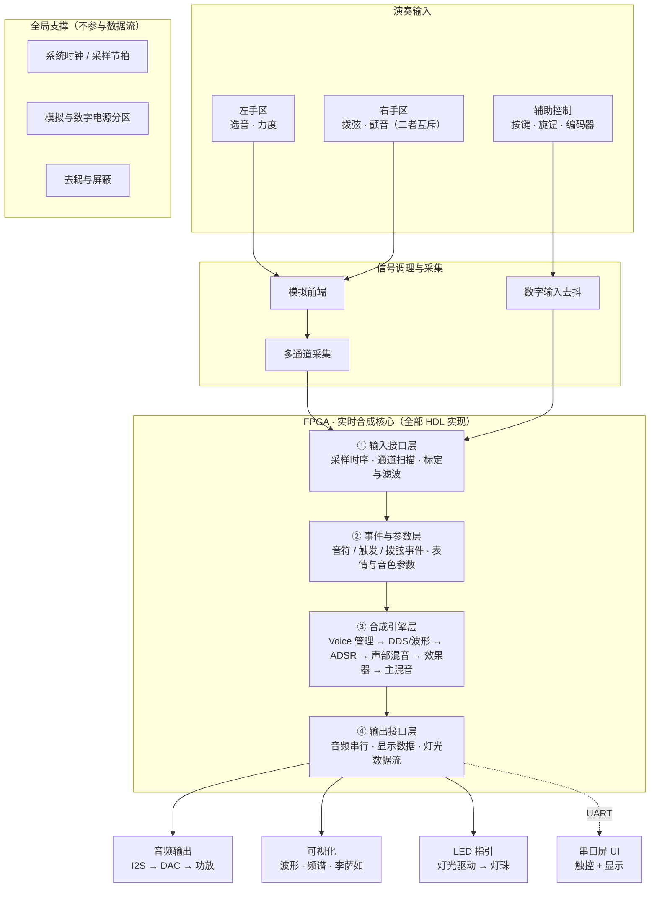
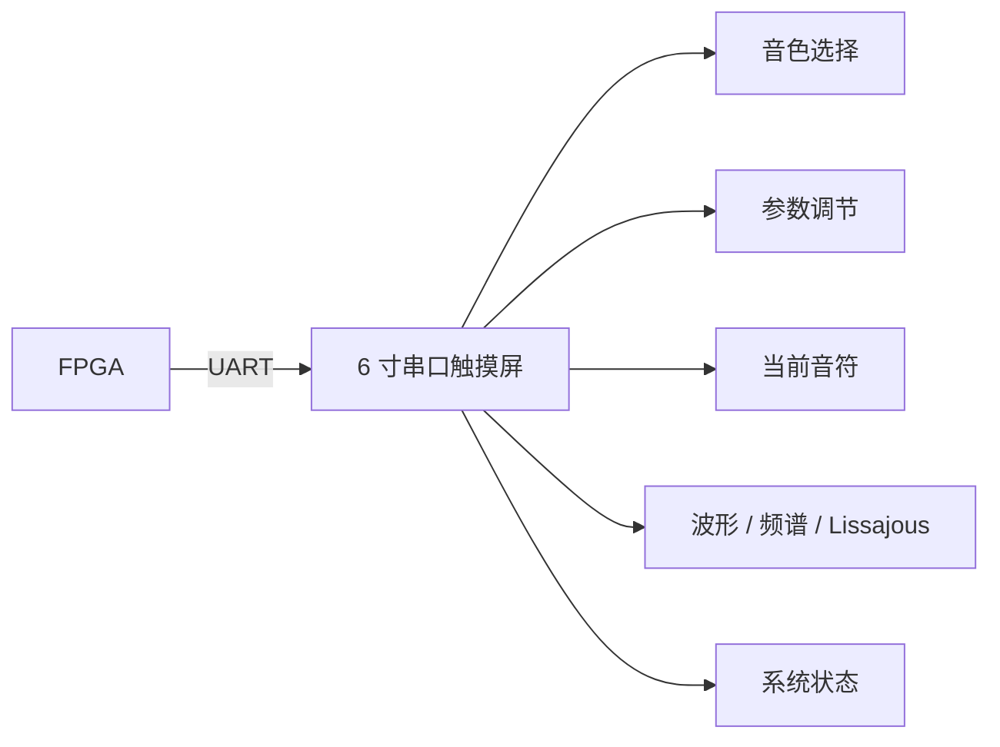

# 2026 嵌入式芯片与系统设计竞赛 · FPGA 电子乐器项目交接文档

> **赛题方向**：FPGA 创新设计方向 —— 基于 FPGA 的实时多音色合成电子乐器引擎
> **文档用途**：硬件负责人 ↔ 各模块队友的接口对齐与进度同步
> **配套**：**`模块决策表.md`（逐模块拍板 · 唯一表决入口）** ｜ **`左手区方案.md`** ｜ `整体模块框图.md` ｜ `方案选择档案.md` ｜ **`硬件接口总表.md`** ｜ `音频输出方案.md` ｜ `LED演奏指引方案.md` ｜ `电源方案.md` ｜ `FPGA平台与资源评估.md`
> **版本**：v1.1（2026-09-12 修订：主时钟改 50 MHz、交互方案转向磁轴） ｜ **维护人**：硬件负责人

---

## 0. 一页速览

| 项目 | 内容 |
|---|---|
| **做什么** | 用 FPGA 做**纯硬件实时音频合成**的电子乐器引擎，不是播放预录 PCM |
| **核心交付** | 一个能真实演奏的交互乐器 + FPGA 实时合成 + 可视化 UI |
| **当前阶段** | **机械原型验证**（正在 3D 打印 **磁轴 + 电容滑条** 的结构件）；方向已由 FSR 转向**磁轴阵列** |
| **硬件负责人负责** | 演奏交互硬件、传感器方案、PCB、机械结构、FPGA 外设接口、音频输出、整体硬件架构 |
| **不负责** | 合成算法本体、音色设计、RTL 架构（属软件/FPGA 侧队友） |
| **当前红线** | **机械结构未定之前，不画最终演奏 PCB** |

### 下一步只需盯这三件事

1. 打完 **磁轴 + 滑条** 的 3D 件，实机试手感
2. ⭐ **验证"手指抖动行程做颤音"的手感** —— 这决定「一维磁轴能不能满足三维表达」
3. 拍板 `硬件与机械结构选型-待队友确认.md` 里的 **D0 / D1 / D2 / D5**

> 🎯 **两条新增的硬约束（优先级高于选型）**：
> 1. **同一只手**要移动来切换的操作，必须发生在同一个平面、同一高度上。
>    ⚠️ 该约束**只对同一只手成立**：不同手各管一块区域时，两区可以完全独立（不必共面）。
>    实测发现"手指从磁轴面移到电容面"会明显卡顿（高度差 + 台阶 + 必须先抬手）。
> 2. **赛题不限制手数** —— 选题指南只规定"维度"，且写明「自主设计演奏交互形态」，
>    双手分工完全合规。所以"一只手还是两只手"不该成为放弃某个方案的理由。
>
> 📄 **速览版见 `方案选择档案.md`** —— 一页看完所有候选方案的长短。

> ⚠️ **方向已更新（2026-09-12，请以新文档为准）**
> 交互方案经实测与询价后**已从 FSR 转向磁轴**，理由见 **`硬件与机械结构选型-待队友确认.md`（v2.0）**：
> - FSR 是**外购薄膜，3D 打印验证不了**，且单价 ≥7 元，比"磁轴 + 线性霍尔"更贵
> - FSR 覆盖在电容电极附近会**屏蔽手指电场**，且压力形变与位置测量**动态耦合、无法标定消除**
> - 磁轴的主要干扰是**静态寄生电容偏移**（磁铁是导体），**上电标定即可化解**
>
> 本文档第 3 章的两个"方案 A/B"仅作为**历史决策记录**保留，**不再是现行方案**。
> 现行的硬件/机械决策请一律查 v2.0 选型文档。

---

## 1. 赛题硬性指标（验收红线）

| 指标 | 要求 | 备注 |
|---|---|---|
| 演奏事件识别 | 音符 / 和弦 / 触发 | 交互层给出事件，FPGA 侧消费 |
| 独立可控演奏维度 | **≥ 2 个**（扩展 **≥ 3 个**） | 本项目拟做：力度 / 音高 / 音色 |
| 合成链 | DDS / 波形发生 → ADSR → 多 Voice 管理 → 混音 | 全部 RTL 实现 |
| 音频输出 | I2S → DAC | 用成品 PCM5102A 模块 |
| **控制→出声延迟** | **≤ 10 ms**（扩展目标 **≤ 5 ms 且确定性**） | 演奏输入必须绕开串口屏 |
| 基础复音数 | **≥ 4** | 起步目标 |
| 扩展方向（三选一） | ≥ 32 Voice ／ ≥ 32 加性合成分量 ／ ≥ 32 并行物理模型单元 | 择一即可 |
| 音色数 | **≥ 2 种** | |
| 效果器 | Reverb / Delay / Chorus 等（FPGA 内实现） | |
| 可视化 | 波形 / 频谱 / Lissajous 等 | 走串口屏显示 |
| **必须证明** | 是 FPGA RTL 实时合成，**不是播放预录 PCM** | 评委重点核查项 |

### ⚠️ 评分陷阱（必须全员知晓）

> **吞吐量按「实际活动振荡器数量 × 实际音频采样率」计算。**
> 单纯拉高采样率**不会**增加吞吐量得分，属于无效努力。
> 正确做法：**把 Voice 数真正做上去**，让并行振荡器数量成为硬指标。

---

## 2. 总体系统架构

> 📐 **完整框图见 `整体模块框图.md`**（或本文档 2.1 的 Mermaid 版）。
> 以下**只描述模块层级，不涉及具体型号**。

### 2.1 主链路：输入 → 处理 → 输出



<details>
<summary>ASCII 版（不方便渲染 Mermaid 时看这里）</summary>

```text
┌────────── 演奏输入 ──────────────────────────────────────┐
│  左手区            右手区              辅助控制            │
│  选音 · 力度       拨弦 · 颤音（互斥）  按键/旋钮/编码器    │
└──────┬────────────────┬──────────────────────┬───────────┘
       ▼                ▼                      ▼
┌────────── 信号调理与采集 ─────────────────────────────────┐
│  模拟前端 ── 多通道采集          数字输入去抖              │
└───────────────────────┬───────────────────────────────────┘
                        ▼
╔══════════ FPGA · 实时合成核心（全部 HDL 实现）══════════════╗
║ ① 输入接口层   采样时序 · 通道扫描 · 标定与滤波            ║
║        ▼                                                  ║
║ ② 事件与参数层 音符 / 触发 / 拨弦事件 · 表情与音色参数   ─╫─→ 串口屏 UI（UART，非演奏通路）
║        ▼                                                  ║
║ ③ 合成引擎层   Voice 管理 → DDS/波形 → ADSR 包络          ║
║                → 声部混音 → 效果器 → 主混音                ║
║        ▼                                                  ║
║ ④ 输出接口层   音频串行 · 显示数据 · 灯光数据流            ║
╚═══════╤═══════════════╤════════════════╤═══════════════════╝
        ▼               ▼                ▼
   ┌─────────┐    ┌──────────┐    ┌──────────┐
   │ 音频输出 │    │  可视化   │    │ LED 指引  │
   │I2S→DAC→ │    │波形·频谱· │    │灯光驱动 → │
   │ 功放音箱 │    │ 李萨如    │    │  灯珠     │
   └─────────┘    └──────────┘    └──────────┘

全局支撑（不参与数据流）：系统时钟/采样节拍 · 模拟与数字电源分区 · 去耦与屏蔽
```
</details>

**两条结构性原则（不要违反）**

| # | 原则 | 原因 |
|---|---|---|
| 1 | **演奏链路与 UI 链路必须分离** | 串口屏的触摸扫描 + UART 传输延迟不可控，**不能进 ≤5 ms 的确定性通路** |
| 2 | **左手区 / 右手区 / 颤音模块互相独立** | 三者由不同的手或不同的动作操作 → **不必共面、可以分板**（详见 `方案选择档案.md` §2.2） |

### 2.2 UI 链路（**独立于演奏链路**）



> **架构原则：演奏输入与 UI 输入必须分离。**
> 串口屏内部有触摸扫描 → 界面处理 → UART 传输等多级延迟，**无法保证 ≤5 ms 确定性**，
> 因此串口屏只做 UI，绝不参与核心低延迟演奏输入。

---

## 3. 演奏交互方案（当前两个候选）

### 3.1 方案 A：磁轴 + 电容滑条 ← **当前正在 3D 打印验证**

```text
下层 PCB ── 磁轴 / Hall ── 按键 + 连续行程信息
上层 PCB ── 电容触摸电极 ── 连续位置 / Pitch Bend / Vibrato
```

| 优势 | 缺点 |
|---|---|
| 按键反馈明确，手感接近传统键盘 | 机械结构复杂 |
| Hall 可得连续按键行程 | 上层 PCB 需为磁轴开孔 |
| 可做 velocity / expression | 磁铁 / Hall IC / 轴体 / PCB 高度关系需精确调 |
| 可设计成键盘模式 | 需实机试手感 |
| 上层 PCB 可做成可更换交互模块 | **「按键 + 滑动」叠加后演奏体验未必自然** |

**当前状态**：机械结构件打印中，尚未确认采用。

### 3.2 方案 B：FSR + 长条电容滑条 ← 文档原始倾向 / **并行备选**

```text
手指
 ├── FSR ── 按压力度 / Note ON / Velocity / Expression
 └── 长条电容滑条 ── 连续位置 → Pitch
```

演奏逻辑：

| 动作 | 映射 |
|---|---|
| 触碰 / 按压 | 触发音符（Note ON） |
| FSR 压力大小 | Velocity / Volume / Expression |
| 电容滑条位置 | 音高 |
| 手指缓慢移动 | Pitch Bend / Glissando |
| 目标音附近快速小幅往复 | Vibrato |
| 另一旋钮 / 滑杆 | 第三表达维度（Filter / Timbre / Effect） |

**定位**：更接近 **无弦电子吉他 / 连续音高电子乐器**，而非普通键盘。

### 3.3 方案对比速查

| 维度 | 方案 A 磁轴 + 电容滑条 | 方案 B FSR + 电容滑条 |
|---|---|---|
| 触发方式 | 按键（有明确段落感） | 按压（连续力度） |
| 力度来源 | Hall 行程 | FSR 压力 |
| 音高来源 | 上方电容电极 | 长条电容滑条 |
| 机械复杂度 | **高**（三层对位、开孔、磁路） | **低**（平面叠层即可） |
| 手感风险 | 按键 + 横向滑动可能别扭 | 按压 + 移动天然连贯 |
| 乐器感 | 偏键盘 | **偏无弦乐器** |
| 当前状态 | **打印验证中** | 备选，未打样 |

### 3.4 为什么暂不主推磁轴

磁轴不是技术不行，而是**核心风险在"按得舒不舒服"，必须靠实物验证**。
「按键 + 上层触摸板 + 手指横向滑动」这个复合动作实测可能别扭；
而 FSR + 滑条的动作天然就是「**按压 + 移动**」，更符合无弦乐器的连续表达逻辑。

**决策路径**：先打样实测 → 体验不好则回退磁轴（或反之）。**在实测之前不锁死方案。**

---

## 4. 演奏输入硬件

### 4.1 FSR（压力传感）

用**成品 FSR**，不自己设计传感器本体。

```text
FSR → 分压 → ADC → SPI → FPGA
```

用途：Note Trigger、Velocity、压力表达、可选 Attack 控制。

### 4.2 长条电容滑条（**自制 PCB 电极**）

```text
┌───────────────────────────────┐
│     长条电容触摸区域          │
│ ═══════════════════════════   │
└───────────────────────────────┘
            X = Pitch
```

电极数为离散量，**需通过插值算法得到连续位置**。

### 4.3 电容触摸控制器

原型阶段优先 **MPR121**：12 通道 / I2C / 自带触摸检测 / 可读电容数据 / 可多电极估连续位置。

**待实测验证项**：采样与扫描速度、分辨率、电极长度适用性、插值稳定性、端到端延迟。
若 MPR121 不达标 → 考虑更高性能方案，或 **FPGA 直接测电容**。

### 4.4 拨弦机构（可选）

若保留右手拨弦动作，用最简方案：**3D 打印拨弦件 + 1～2 个微动开关**。

```text
拨弦 → 微动开关 → GPIO → pluck_trigger
```

需区分上下拨则用两个开关，否则一个足够。**不要一上来就设计复杂机械拨弦机构。**

### 4.5 FSR 与电容区的机械布局（防耦合）

曾考虑「FSR → 绝缘层 → 电容电极」的三层堆叠，理论可行，但存在**耦合问题**：
FSR 材料、人体接触、压力形变都会改变电容测量值。

**因此优先做法：FSR 区与主要电容滑条区物理分开。**

```text
┌───────────────────────────────┐
│       电容 Pitch 区域         │
│ ═══════════════════════════   │
├───────────────────────────────┤
│           FSR 区域            │
│         █████████             │
└───────────────────────────────┘
```

最终布局以 3D 模型 + 实物实验确定。

---

## 5. 音频输出硬件

> 📄 **详细方案见 `音频输出方案.md`**（含接线级说明、FPGA 预留接口、时钟分频方案）

**用 DAC 成品模块，不要一开始自己设计 DAC。**

### 5.1 关键认知：输出其实是"两段"

```text
FPGA --I2S--> DAC 模块 --Line Out--> ┬--> 3.5mm → 有源音箱（用它的功放）
                                     └--> 功放模块 → 小扬声器
```

> 🔴 **DAC 出来的是"线路电平"，推不动扬声器。**
> **接有源音箱 = 用音箱里的功放；接小扬声器 = 必须自己加一级功放。**
> 所以"两种用法"不是两个 DAC，而是**同一路 Line Out 后面分两路走**。

### 5.2 要点

| 要点 | 说明 |
|---|---|
| 为什么用成品 DAC 模块 | 可直接接受 I2S 音频数据，省掉 DAC 设计与调试 |
| 开发阶段 | 用现有 Bass Amp 的 **AUX IN** |
| ⚠️ 不要接 | **INPUT**（这是乐器输入口，电平与阻抗不匹配） |
| 两路输出 | DAC Line Out 同时接「3.5mm 插座」与「功放模块」；若两路输入阻抗都 ≥10 kΩ 可直接并联，否则用**带常闭触点的插座**自动切换 |
| ⚠️ 功放注意 | 若功放是 **BTL 桥接输出**，两个声道的负端**不能相连、不能接地**，否则烧芯片 |
| 音量 | 建议**数字侧为主**（接 UI），模拟侧固定增益留余量 |
| 防爆音 | 上电顺序 + 静音/使能引脚 + 数字渐入（三者可叠加） |

### 5.3 FPGA 侧预留接口

| 信号 | 必需性 |
|---|---|
| `I2S_BCLK` / `I2S_LRCLK` / `I2S_DIN` | **必需**（3 根） |
| `I2S_MCLK` / `DAC_MUTE` / `AMP_EN` | **建议预留**（一次留到位，后面换模块不改板） |
| 3V3 / 5V / **GND ×2~3** | 功放电流大，地线要**多留几根** |

**时钟分频（全是整数、无抖动）**

```text
MCLK  = 50 MHz ÷ 4 = 12.500 MHz = 256 × fs
BCLK  = MCLK ÷ 4   =  3.125 MHz =  64 × fs
LRCLK = MCLK ÷ 256 = 48.828 kHz          ← fs
```

> 💡 **fs 不必是精确的 48.000 kHz**：音高 = 相位增量 × fs / 2^N，
> 只要相位增量按同一个 fs 反算，**输出音高就是精确的**，fs 偏差听不出来。

---

## 6. 采购 / 自制 分工清单

### 6.1 直接买成品模块

| 类别 | 物料 | 数量 |
|---|---|---|
| 音频 | PCM5102A DAC 模块 | ×1 |
| 触摸 | MPR121 电容触摸模块 | ×1 |
| 采集 | SPI ADC 模块 | ×1 |
| 传感 | FSR | 若干 |
| 交互 | 微动开关 | ×2～4 |
| 交互 | 电位器 | ×2～4 |
| 交互 | 旋转编码器 | ×1～2 |
| 交互 | 普通按键 / LED | 若干 |
| 结构 | 音频接口、排针排母/连接器 | 若干 |
| 音频 | 必要功放 / 音箱 | 按需 |

### 6.2 自己画 PCB（只做这两块）

**① 演奏传感器 PCB**（最值得自己设计的一块）

```text
长条电容电极 + FSR 接口 + ADC + MPR121 + 传感器接口 + FPGA 接口
```

**② FPGA 扩展 / 接口 PCB**

统一整理 I2C / SPI / I2S / UART / GPIO / 电源，方便后续更换传感器与外设。

### 6.3 3D 打印件（Bambu A1）

乐器主体、FSR 固定结构、电容滑条外壳、拨弦机构、PCB 固定件、屏幕支架、手指定位结构、防滑脚。

> **当前优先任务：先打印交互部分模型，验证手感和尺寸。**

### 6.4 ❌ 明确不做（别浪费时间）

DAC 芯片设计、功放 PCB、音箱设计、复杂蓝牙模块、复杂触摸 IC、电源模块。

> 本项目真正值得投入设计的只有四件事：
> **演奏交互 + 实时合成 + 多 Voice + 音效 + 可视化。**

---

## 7. FPGA 内部模块与硬件接口面

```text
Input Interface → Sensor Processing → Note/Event Manager → Voice Manager
→ DDS/Oscillator → ADSR → Voice Mixer → Effects → Master Mixer → I2S TX

并行：Audio Data ├→ Waveform Display ├→ FFT/Spectrum └→ Lissajous
UI ：UART RX/TX → Parameter Manager → 音色/ADSR/Effects 参数
```

### 音频参数与时钟预算

| 参数 | 取值 | 推算 |
|---|---|---|
| 采样率 | **48 kHz**（初期） | — |
| FPGA 主时钟 | **`sys_clk = F13 @ 50 MHz`**（基石板实测） | 50 MHz ÷ 48 kHz ≈ **1041 clk / sample** |

> **结论**：完全没必要要求"一个时钟周期算完所有 Voice"。
> 可用 **时分复用 + Pipeline + 多周期计算** 换取更多 Voice。
> **复音数扩张路线**：`4 → 8 → 16 → 32`（逐级推进，不一次到位）。
>
> 📌 修正：文档早期版本按 100 MHz 举例，基石板实测为 **50 MHz**，每样本约 **1041 个时钟**。

---

## 8. 开发路线图（带阶段门）

| # | 阶段 | 主要交付物 | 准入条件 |
|---|---|---|---|
| ① | 3D 模型 | 交互结构件数模 | — |
| ② | **机械 / 演奏体验验证** | 手感结论（方案 A vs B） | ← **当前所在阶段** |
| ③ | **确定交互结构** | 冻结的机械方案 | ② 通过 |
| ④ | 采购 | FSR / MPR121 / ADC / PCM5102A | ③ 通过 |
| ⑤ | 传感器单元验证 | 采集数据 + 延迟实测 | ④ 到货 |
| ⑥ | FPGA 输入接口 | Input Interface RTL | ⑤ 通过 |
| ⑦ | 最小音源 | 单音 DDS 出声 | ⑥ 通过 |
| ⑧ | **I2S + DAC 出声** | 完整音频链路打通 | ⑦ 通过 |
| ⑨ | 多 Voice | 4 → 8 → 16 → 32 | ⑧ 通过 |
| ⑩ | ADSR / 音色 | ≥2 音色 | ⑨ 通过 |
| ⑪ | Effects | Reverb / Delay / Chorus | ⑩ 通过 |
| ⑫ | 可视化 | 波形 / 频谱 / Lissajous | ⑪ 通过 |
| ⑬ | 最终 PCB / 机械整合 | 成品乐器 | 全部通过 |

> 🔴 **阶段门红线：机械结构未确定前，不画最终演奏 PCB。**
> 这是避免"结构一改、PCB 全废"的关键纪律，请队友共同遵守。

---

## 9. 未决问题清单（Open Questions）

| # | 问题 | 影响面 | 负责 / 验证方式 | 状态 |
|---|---|---|---|---|
| 1 | 磁轴 + 滑条实际按起来是否舒服 | 机械 / 交互 | 3D 打印件实测 | 🔄 进行中（打印中） |
| 2 | FSR + 长条滑条手感（对比项） | 机械 / 交互 | 打样后实测 | ⏳ 待打样 |
| 3 | 长电容滑条的长度与宽度 | 机械 / PCB | 手感 + 电极仿真 | ⏳ 待定 |
| 4 | 电容电极数量 | PCB / 算法 | 分辨率 vs 布线权衡 | ⏳ 待定 |
| 5 | MPR121 扫描速度与实际延迟是否达标 | 系统延迟 | 上板实测 | ⏳ 待测 |
| 6 | FSR 与电容区如何布局避免干扰 | 机械 / PCB | 实物实验 | ⏳ 待定 |
| 7 | 是否需要独立拨弦机构 | 交互完整性 | 演奏需求讨论 | ⏳ 待定 |
| 8 | 是否加入第三表达维度 | 交互 / 指标 | 组内决策 | ⏳ 待定 |
| 9 | 是否保留磁轴作为备用/第二交互模式 | 架构 | 组内决策 | ⏳ 待定 |
| 10 | 最终目标 Voice 数量 | FPGA 资源 | 资源评估 | ⏳ 待定 |
| 11 | 最终音色种类及合成方式 | 算法 | FPGA 侧主导 | ⏳ 待定 |
| 12 | Effects 具体选型 | 算法 / 资源 | FPGA 侧主导 | ⏳ 待定 |
| 13 | 最终外壳与 PCB 尺寸 | 机械 / 结构 | ③ 之后 | ⏳ 阻塞中 |

---

## 10. 风险与对策

| 风险 | 触发条件 | 对策 |
|---|---|---|
| 磁轴方案手感不佳 | 打印件实测别扭 | 回退方案 B（FSR + 滑条） |
| FSR 方案手感不佳 | 打样实测别扭 | 回到方案 A，或改用第三种触发方式 |
| MPR121 延迟/分辨率不足 | 上板实测超 5 ms 或插值抖 | 换高性能触摸 IC，或 FPGA 直接测电容 |
| FSR 与电容互相干扰 | 实测电容基线漂移 | 物理分区，必要时加屏蔽层/接地岛 |
| 串口屏延迟污染演奏链路 | 误用串口屏做演奏输入 | **架构上强制分离**：屏只做 UI |
| 吞吐量得分被误解 | 靠拉高采样率刷分 | 全员明确：得分 = 活动振荡器数 × 采样率 |
| 结构反复改导致 PCB 报废 | 提前画最终 PCB | 严守阶段门红线 |

---

## 附录 A · 术语表（给非硬件队友）

| 术语 | 一句话解释 |
|---|---|
| **DDS** | 直接数字频率合成，用相位累加器产生波形，音高精度高、切换快 |
| **ADSR** | 音符包络：起音 / 衰减 / 保持 / 释放，决定音色的"软硬" |
| **Voice** | 一个可独立发声的合成单元；复音数 = 同时能响的 Voice 数 |
| **Voice Manager** | 负责分配 / 抢占 / 释放 Voice 的调度模块 |
| **FSR** | 压阻式压力传感器，按得越重电阻越小；**外购薄膜件，无法自行加工** |
| **磁轴** | 键盘用机械轴，内部带磁铁；配霍尔传感器测行程，**手感与成本优于 FSR** |
| **数字霍尔 / 线性霍尔** | 数字霍尔只输出 0/1（键盘常用）；**线性霍尔输出随磁场连续变化的模拟量**，才能得到连续行程与力度 |
| **颤音 Vibrato** | 音高的低频周期调制（典型 4～7 Hz），听感上是"揉弦" |
| **滑弦 Glissando** | 音高连续滑动，听感上是"抹过去"，与颤音是两种不同的动作 |
| **latency 分级** | 触发/音高对延迟敏感；**颤音通道对延迟不敏感**（低频调制，几十 ms 听不出）——选架构时的关键原则 |
| **MPR121** | 12 通道电容触摸控制器，I2C 接口 |
| **I2S** | 数字音频串行总线（BCLK / LRCLK / DATA） |
| **PCM5102A** | I2S 输入、模拟 Line Out 输出的成品 DAC 芯片/模块 |
| **Lissajous** | 李萨如图形，用两路信号互绘形成的可视化图形 |
| **确定性延迟** | 延迟有上界且可预测，不随负载抖动 —— 比"平均延迟低"更重要 |

## 附录 B · 接口预留

> 📌 **已独立成文：所有要预留的硬件接口汇总在 `硬件接口总表.md`**（J1～J10）。
> PCB 排针时**以那份表为准**，本文不再重复。

速查：

```text
J1 音频输出 5pin | J2 UI 串口屏 4pin | J3 左手区传感器 10pin（通用型）
J4 拨弦 4pin | J5 颤音模块 6pin | J6 辅助控制 8pin | J7 LED 指引 5pin
J8 调试测试点 | J9 电源（5V/3V3/GND 多根） | J10 备用通用 IO 6pin
```

## 附录 C · 待办与负责人（组会同步用）

| 事项 | 负责人 | 截止 | 备注 |
|---|---|---|---|
| 磁轴 + 滑条件打印与试装 | 硬件 | — | 进行中 |
| FSR + 滑条对比件打印 | 待认领 | — | 建议同步做 |
| 机械方案冻结评审 | 全员 | — | ② 阶段出口 |
| MPR121 延迟实测 | 待认领 | — | 需先到货 |
| FPGA 音源最小闭环 | FPGA 侧 | — | 与结构解耦，可并行 |
| **待确认：文档口径统一（方案 A 为当前验证对象）** | 全体 | 下次组会 | 见 §0 提醒 |

---

## 十五、当前总体判断（结论）

**最推荐方向**：

```text
FPGA + FSR + 长条电容滑条 + 简单拨弦 + PCM5102A + 串口屏
```

| 角色 | 器件 | 职责 |
|---|---|---|
| 力度 / 触发 | FSR | Velocity、Note ON |
| 连续音高 | 电容滑条 | Pitch / Bend / Vibrato |
| 拨弦触发 | 微动开关 | Pluck Trigger |
| 第三维度 | 旋钮 | Filter / Timbre / Effect |
| UI | 串口屏 | 参数与可视化 |
| 合成核心 | FPGA | 全部实时音频合成 |
| 音频输出 | PCM5102A | I2S → 模拟 Line Out |

**方案优势**：结构相对简单、交互逻辑自然、容易体现"电子乐器"特色，
并且把技术含量集中到 **FPGA 实时音频合成** 上 —— 这正是赛题的评分重心。

**磁轴 + 电容滑条保留为并行方案。** 若打印实测后发现 FSR 方案手感不好，再重新评估磁轴。

> **纪律：当前不要过早锁死具体传感器型号和 PCB。先完成机械原型和传感器实验。**
