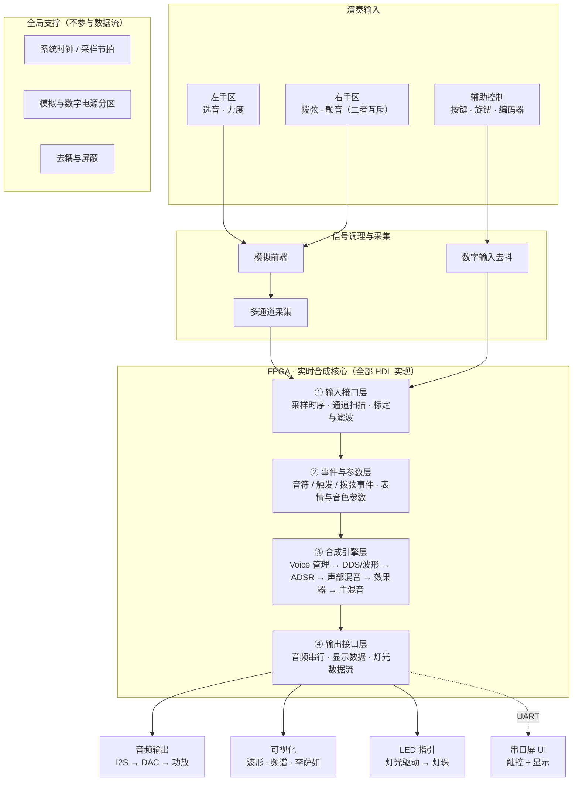

# 电子乐器系统 · 整体模块框图

> **用途**：给队友看"系统由哪些模块组成、数据怎么流"
> **口径**：**只描述模块层级，不涉及具体型号**（型号待选型文档冻结后再落）
> **日期**：2026-09-12
> **配套**：`FPGA电子乐器项目-交接文档.md`（总纲）｜`方案选择档案.md`（器件选型）｜**`硬件接口总表.md`（排针依据）**｜**`模块决策表.md`（逐模块拍板）**｜**`左手区方案.md`**｜`音频输出方案.md`｜`LED演奏指引方案.md`｜`电源方案.md`｜`FPGA平台与资源评估.md`

---

## 一、主链路：输入 → 处理 → 输出



### ASCII 版（不方便渲染 Mermaid 时看这里）

```text
┌────────── 演奏输入 ──────────────────────────────────────┐
│  左手区            右手区              辅助控制            │
│  选音 · 力度       拨弦 · 颤音（互斥）  按键/旋钮/编码器    │
└──────┬────────────────┬──────────────────────┬───────────┘
       ▼                ▼                      ▼
┌────────── 信号调理与采集 ─────────────────────────────────┐
│  模拟前端 ── 多通道采集          数字输入去抖              │
└───────────────────────┬───────────────────────────────────┘
                        ▼
╔══════════ FPGA · 实时合成核心（全部 HDL 实现）══════════════╗
║ ① 输入接口层   采样时序 · 通道扫描 · 标定与滤波            ║
║        ▼                                                  ║
║ ② 事件与参数层 音符 / 触发 / 拨弦事件 · 表情与音色参数   ─╫─→ 串口屏 UI（UART，非演奏通路）
║        ▼                                                  ║
║ ③ 合成引擎层   Voice 管理 → DDS/波形 → ADSR 包络          ║
║                → 声部混音 → 效果器 → 主混音                ║
║        ▼                                                  ║
║ ④ 输出接口层   音频串行 · 显示数据 · 灯光数据流            ║
╚═══════╤═══════════════╤════════════════╤═══════════════════╝
        ▼               ▼                ▼
   ┌─────────┐    ┌──────────┐    ┌──────────┐
   │ 音频输出 │    │  可视化   │    │ LED 指引  │
   │I2S→DAC→ │    │波形·频谱· │    │灯光驱动 → │
   │ 功放音箱 │    │ 李萨如    │    │  灯珠     │
   └─────────┘    └──────────┘    └──────────┘

全局支撑（不参与数据流）：系统时钟/采样节拍 · 模拟与数字电源分区 · 去耦与屏蔽
```

---

## 二、各层职责

| 层 | 职责 | 边界 |
|---|---|---|
| **① 演奏输入** | 产生原始动作信号 | 硬件侧负责（传感器 + 机械结构） |
| **② 信号调理与采集** | 把物理量变成可用的数字量 | 硬件侧负责（模拟前端 + ADC / 触摸 IC / 去抖） |
| **③ FPGA 内部** | 事件识别 + 参数生成 + 实时合成 + 输出驱动 | 与 FPGA 侧分工，**硬件侧负责接口定义与时序约束** |
| **④ 输出** | 音频 / 视觉 / 灯光三类输出 | 硬件侧负责音频与灯光通路；可视化由 FPGA 侧生成数据 |
| **⑤ 全局支撑** | 时钟、电源、地、屏蔽 | 硬件侧负责 |

---

## 三、FPGA 内部四层拆解

| 层 | 输入 | 输出 | 关键点 |
|---|---|---|---|
| **① 输入接口层** | 采集到的原始数据 | 标定、滤波后的规范化量 | 采样时序必须**确定**；标定系数来自上电自校 |
| **② 事件与参数层** | 规范化量 | **音符事件** + **表情参数** | ⭐ 这两类**必须分开**：事件进 Note Manager，参数进 Parameter Manager，**参数永不产生音符** |
| **③ 合成引擎层** | 音符事件 + 参数 | 逐样本音频数据 | 全部 HDL 实现；**严禁播放预录 PCM** |
| **④ 输出接口层** | 音频数据 / 可视化数据 / 灯光数据 | 三路数字输出 | 三路并行，互不阻塞 |

> ⭐ **② 层的"事件 / 参数分离"是整个架构的关键设计**：
> - **事件**（选音、触发、拨弦）→ 驱动 Note ON/OFF
> - **参数**（力度、颤音、表情、音色）→ 持续调制
>
> 把这两类**在架构上分开**，可以避免"调制动作被误判成新的音符"——
> 这是"误触发"问题的**结构性解法**，不依赖算法判断。

---

## 四、两条不可违反的结构原则

| # | 原则 | 原因 |
|---|---|---|
| **1** | **演奏链路与 UI 链路必须分离** | 串口屏的触摸扫描 + UART 传输延迟**不可控**，不能进 ≤5 ms 的确定性通路。屏只做 UI，**不做演奏输入** |
| **2** | **左手区 / 右手区 / 颤音模块互相独立** | 三者由**不同的手或不同的动作**操作 → **不必共面、可以分板**（详见 `方案选择档案.md` §2.2） |

---

## 五、延迟预算（按通路分级）

| 通路 | 延迟敏感度 | 说明 |
|---|---|---|
| **触发 / 拨弦 → 发声** | 🔴 最敏感 | 决定"音符什么时候响" |
| **选音 / 音高** | 🟠 敏感 | 延迟 = 音符迟到；抖动 = 音高不稳 |
| **力度** | 🟡 中 | 与触发时刻绑定，取触发瞬间值即可 |
| **颤音 / 调制** | 🟢 不敏感 | 低频调制，几十 ms 更新听不出来 |
| **可视化 / LED 指引** | ⚪ 无要求 | 只要视觉上同步即可 |

> ➡️ **分配原则**：把"延迟不确定"的器件，分配到**唯一不敏感**的通路上。

---

## 六、时钟与节拍

| 项 | 值 |
|---|---|
| 板载系统时钟 | **50 MHz** |
| 音频采样率 | 48 kHz（初期） |
| 每样本可用时钟 | 50 MHz ÷ 48 kHz ≈ **1041 clk / sample** |

> 结论：**不需要一个时钟周期算完所有 Voice** ——
> 可用**时分复用 + 流水线 + 多周期计算**换取更多并行声部。

---

## 七、待冻结项（本框图刻意留空的部分）

| # | 待定内容 | 决策处 |
|---|---|---|
| 1 | 左手区选音用什么传感器 | `方案选择档案.md` D1 / D2 |
| 2 | 右手区拨弦用什么器件 | 同上 D6 |
| 3 | 颤音用推子还是电容条 | 同上 §2.3 |
| 4 | LED 指引的承载方式 | 同上 §六 / D10 |
| 5 | 板卡划分（单板 / 双板 / 三层） | 同上 D9 |
| 6 | 具体器件型号 | 冻结信号形态之后再选 |

> 📌 **接口针脚一律查 `硬件接口总表.md`** —— 那份表才是 PCB 排针的唯一依据。

> ⚠️ 本框图的模块层级**不随型号变化** ——
> 所以可以先把框图定下来，再逐项填型号，不必等选型完成。
